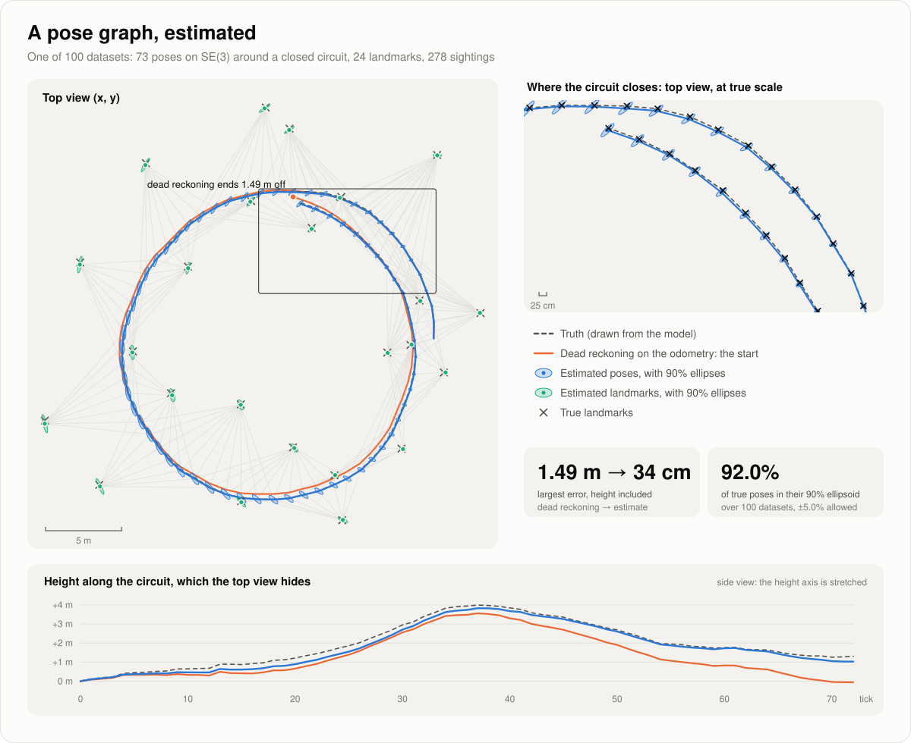
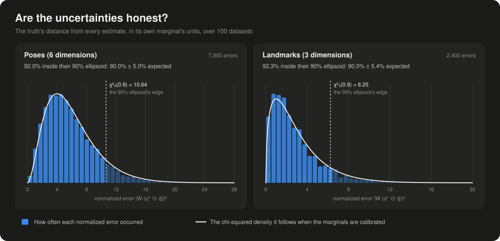
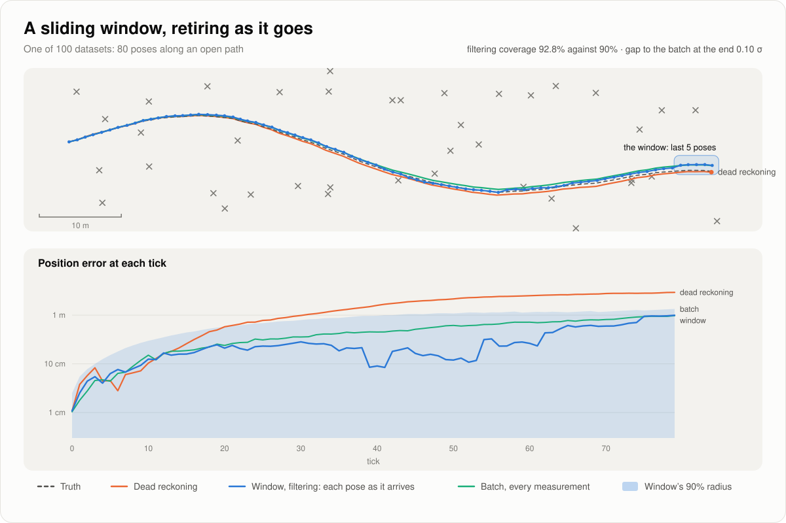

# skoro

Probabilistic modeling in Rust.

<p align="center">
  <a href="https://skoro.dev/guide/pose-graph/"></a>
</p>

skoro writes a model once, generatively, and runs inference on it. Above, a robot's poses on
SE(3) and the landmarks it sights, built tick by tick, are drawn a hundred times from the model and
estimated together by Levenberg–Marquardt; below, the Laplace marginals at the mode contain the
truth as often as they claim to. Both are the example
[`pose_graph`](crates/skoro/examples/pose_graph.rs), which CI runs, and which fails when they do not.

<p align="center">
  <a href="https://skoro.dev/guide/pose-graph/#are-the-uncertainties-honest"></a>
</p>

The same model, kept to a window of its last five poses and retiring the oldest at every tick into
a linearized factor, filters an open path:
[`sliding_window`](crates/skoro/examples/sliding_window.rs).

<p align="center">
  <a href="https://skoro.dev/guide/sliding-window/"></a>
</p>

```sh
cargo run --release -p skoro --example pose_graph
cargo run --release -p skoro --example sliding_window
```

The documentation, with the mathematics and the archive of how each part came to be, is at
**[skoro.dev](https://skoro.dev/)**. It is rebuilt from every push
that passes CI, so it also shows drafts in progress.

## Where it comes from

This repository started over on 2026-10-09. Everything written before then (the crates, the
documentation site, and their history) is kept on the
[`archive`](https://github.com/mvarble/skoro/tree/archive) branch. It is being brought back one
piece at a time, each piece with a written record of the mathematics and the design behind it.

## How it is developed

Every change is an entry in the archive (`site/content/archive/`), moved through stages in a
branch of its own: for a feature, the mathematics, an implementation companion, a plan, the build,
and last the documentation pages that say what now is. Each stage is approved by a person before
the next begins, and an approved document is frozen unless its stage is reopened.

- [`AGENTS.md`](AGENTS.md): how to work in this repository, for people and agents alike.
- [`.agents/reference/workflow.md`](.agents/reference/workflow.md): the procedure.
- `bin/wf`: the command line that keeps the record and enforces it (`bin/wf help`).
- [`site/`](site/README.md): the documentation (`cd site && pnpm install && pnpm dev`).

## License

[MIT](LICENSE).
